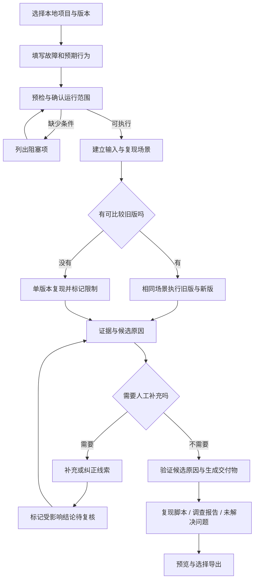

# 软件故障调查工作台 PRD

版本：0.1（供评审与开发拆分）  
日期：2026-10-15  
状态：产品设计；本文描述计划能力，不表示已经实现或验证。  
暂定名称：软件故障调查工作台（基于 REA）。对外名称、商标与上游项目关系在发布前另行确认；产品不冒充 REA 官方产品。

配套文档：[整体架构](02-Architecture.md)、[开发计划与验收](03-Development-Plan.md)。本文规定产品需求；技术合同和接口以架构文档为准。

## 1. 产品决策

为维护 Electron / JavaScript 应用的开发者，提供一个本地优先、可人工介入的 Bug 调查工作台。用户围绕一个具体故障提交问题，系统帮助建立复现、组织代码和运行证据、检查候选原因，最后留下能供人核对和继续执行的调查结果。

三个方向的关系：方向 3 定义要完成的任务，方向 1 提供证据和协作界面，方向 2 提供经过验证的环境模板。首版交付本机运行能力；容器只覆盖适合容器运行的辅助任务。macOS 桌面应用仍在本机运行。

核心承诺：**让调查过程可核对、可纠正、可继续，并把能复现的问题留下重跑入口。**

不承诺：任意应用零配置、所有故障都能复现、结论自动正确、自动修复所有 Bug，也不声称市场独有。

### 1.1 需要验证的产品假设

| 假设 | 验证方法 | 不成立时的调整 |
|---|---|---|
| 跨 renderer / preload / main 的调查是目标用户反复遇到的成本 | 对 3—5 位维护者访谈，收集约 10 个历史或当前故障 | 重新选择任务类型，不因已有实现继续扩大范围 |
| REA 能在选定的 Electron 项目中提供比普通代码检索更有用的关系与证据 | 同一问题分别使用维护者原有工具和本产品，记录证据质量与人工耗时 | 降低 REA 依赖或进一步收窄适配场景 |
| 用户愿意在未知节点补充线索，而不是只等最终答案 | 观察真实任务中的介入次数、介入原因及是否推进调查 | 将主交互收敛为清晰任务流，图只作辅助 |
| 可重跑结果比单独的自然语言报告更有价值 | 请另一位开发者使用调查包独立重跑和复核 | 调整交付物格式和前置条件记录 |
| 本地运行可降低私有项目接入阻力 | 记录试点接入中止原因和外发数据限制 | 提供兼容模型接入；仍不默认建设云平台 |

“稀缺性”是待验证的定位假设。首批用户反复使用、调查成果可复核，优先于功能数量或界面复杂度。

## 2. 用户、任务与边界

### 2.1 首批用户

- 维护有源码、可调试 Electron 应用的个人开发者或小型研发团队。
- 接手陌生桌面项目，需要追踪前端事件到主进程行为的开发者。
- 最近升级依赖、改造 IPC 或重构文件导出等功能的维护者。

### 2.2 用户任务（JTBD）

1. 当一个用户操作在新版本失效时，我希望快速得到可靠的复现步骤和对照结果，避免在多个进程、日志与源码之间反复切换。
2. 当系统查到缺少业务背景的节点时，我希望补充一句有来源的线索，并知道它影响了哪些判断。
3. 当我要请同事接手时，我希望交付可验证的证据、执行记录和未解决问题，避免从头解释。

### 2.3 首版支持边界

| 项目 | P0 边界 |
|---|---|
| 操作系统 | macOS Apple Silicon；具体版本范围在技术验证后冻结并写入兼容矩阵 |
| 使用方式 | 单机、单用户、本地 Web 工作台；用户已有本机开发环境 |
| 项目 | 有源码或可调试构建，且开发者已能成功启动的 Electron / JavaScript 项目；无源码时静态定位覆盖受限；Node 工具链采用选定模板 |
| 调查对象 | 一个明确操作及其故障；优先文件导出、IPC 调用和依赖升级引起的行为变化 |
| 运行配置 | 用户提供或确认启动命令、构建命令、必要环境配置、预期行为与观察方式 |
| 版本对照 | 可提供两个 Git 提交或两个可比较的本地工作目录；每个目录固定版本标识 |
| 单版本 | 允许调查和尝试复现，但结果不得称为“版本回归已确认” |
| 应用数据 | 使用专门测试目录、脱敏数据与测试账户；用户确认允许执行相关操作 |
| 模型 | 使用用户配置的模型服务；本地运行不等于模型推理也在本地 |

预检失败时清楚显示缺少的前置条件。不能通过兼容性检测的项目不进入无人值守调查。

## 3. 完整用户流程

示例问题：“升级后导出带中文文件名的文件失败，旧版本正常。”示例只用于说明产品行为，不代表已复现的真实故障。

### 3.1 创建调查

用户选择项目，填写“发生了什么”“期望发生什么”“如何触发”，可补充错误日志、截图及最近变更。系统识别版本和运行配置，让用户确认目标目录、允许操作的测试目录与启动方式。

有旧版时，将两版映射到独立工作目录和独立测试数据，避免串用构建产物、缓存或用户状态。版本、依赖锁文件、关键配置和场景输入共同构成对照上下文。存在关键差异且无法消除时，显示“环境差异未排除”。

### 3.2 建立复现

用户提供或确认操作步骤；P0 使用有限动作模板或维护者补充的选择器与脚本，不承诺任意手动操作都能被通用录制并自动转换。系统记录每一次执行的输入、步骤、前置状态、观察结果和判定依据。

“旧版通过 / 新版失败”必须引用实际运行记录；不能仅由 Git 差异或模型判断生成。自动判断无法覆盖的业务行为，由用户确认并显示确认者与时间。

默认稳定性判据：同一冻结用例在每版独立重置后各运行 3 次，基线全部通过、候选全部出现相同目标失败，且执行器没有错误，才标记“回归已确认”。这是首版工程规则，不是统计置信保证。少量初步尝试、混合结果或只有人工主观判断时保留不确定性，不能使用相同标签。

### 3.3 调查与人工介入

工作台持续展示调查目标、已完成步骤、最新观察、下一步和阻塞原因。主视图以时间线和证据为主，链路图辅助查看因果假设和依赖。

用户可以对某个节点：补充背景、添加证据、否定假设、标记过时、要求继续验证。人工信息以 `user_assertion` 保留来源；未经验证的业务说明显示为“人工提供，待验证”。原始工具结果和运行证据不可被人工覆盖，纠正以新增声明、关联证据或撤回声明的记录表达。

当补充、纠正或撤回一条线索，或把证据标记为不适用于当前上下文时，所有依赖该信息的结论标记“待复核”，旧结果保留在历史中。系统重查受影响部分；若依赖范围不确定，明确显示并保守扩大复核范围，P0 不承诺最小重算算法。

### 3.4 暂停、继续与失败恢复

P0 在步骤边界接受暂停、补充和恢复。用户请求暂停后不再派发后续动作，当前已开始的动作按可取消能力处理，已经执行的步骤及外部影响保留。恢复时先检查项目版本、配置和必要应用状态是否发生变化。

恢复表示从有效检查点继续调查，不保证恢复被终止的应用进程、临时登录态或全部内存状态。无法恢复时给出重置步骤或重新建立场景或补充脚本要求。

### 3.5 结果与交付

结果页优先回答：

1. 是否复现，依据是什么？
2. 是否形成可比较的版本回归证据？
3. 已支持的候选原因是什么，有哪些反证与限制？
4. 还有什么没查清，需要什么输入？
5. 如何独立重跑、继续调查或交给同事？

系统输出调查报告、证据索引、运行上下文、可重跑脚本以及待确认清单。只有适用且能写出明确断言时才生成回归测试；生成的测试需要在本次环境中运行后显示结果。测试执行与模型提出测试方案必须区分。

## 4. 页面与交互

| 页面 | 主要内容 | 用户完成的决策 |
|---|---|---|
| 项目与调查列表 | 项目路径、版本、调查状态、最后活动、阻塞原因 | 进入已有调查或创建新调查 |
| 新建调查向导 | 故障描述、版本对照、输入、启动配置、允许范围、预检 | 确认调查对象和操作边界 |
| 调查工作台 | 时间线、当前步骤、任务状态、可折叠链路图、证据侧栏 | 判断是否继续、补充信息、暂停 |
| 节点详情侧栏 | 结论、原始证据、来源、版本、依赖、反证、历史 | 核对、纠正或要求验证 |
| 复现与对照页 | 两版步骤、环境差异、执行次数、成功/失败/不确定结果 | 确认是否构成可比较的回归 |
| 结果与导出页 | 报告、脚本、测试结果、未解问题、导出清单与风险提示 | 选择交付内容并导出 |
| 本地设置 | 模型连接、数据保留、兼容模板、可执行工具范围 | 配置运行与数据处理方式 |

颜色只作辅助：状态同时使用文字和图标；不以红绿颜色作为唯一信息。证据看板使用“有支持证据 / 待验证 / 被反驳 / 已过时”等状态，不把“查到了文件”显示为“事实已证明”。

## 5. 需求优先级与验收条件

P0 是可用于真实试点的完整最小闭环，P1 为试点后增强，P2 为验证需求后扩展。

| ID | 优先级 | 需求 | 可观察的验收条件 |
|---|---|---|---|
| P-001 | P0 | 本地项目导入与版本固定 | 每次调查显示项目根目录和版本标识；存在未提交修改时记录快照标识；后续变更不会被无提示当作原版本 |
| P-002 | P0 | 启动与兼容性预检 | 模板、命令、工具和可写测试目录均有检测结果；失败给出具体阻塞项与修正入口 |
| P-003 | P0 | 明确场景与预期 | 开始前保存输入、步骤、预期、判定方式；缺少关键业务预期时要求补充或明确标为未知 |
| P-004 | P0 | 双版本对照 | 在记录的前置状态和输入下分别运行；报告关键环境差异；无法比较时不显示回归已确认 |
| P-005 | P0 | 单版本调查 | 可独立执行调查；结果显著显示“无旧版对照”，不会生成旧版通过的记录 |
| P-006 | P0 | 执行与证据可追溯 | 每条支持结论可打开原始证据和对应运行/代码版本；工具错误与空结果不当作阴性证据 |
| P-007 | P0 | 观察、假设、未知区分 | 三类节点各有明确类型、来源和状态；模型推测不能直接生成运行事实 |
| P-008 | P0 | 人工线索与纠正 | 在步骤边界补充并保存记录的时间和来源；纠正后依赖结论进入待复核；撤回线索也触发复核；原始证据不被改写 |
| P-009 | P0 | 检查点与恢复 | 正常暂停、进程崩溃后保留已完成记录；恢复前检查版本/配置变化；强制中断的动作结果标为未知并先核对；未确认执行结果不得自动标成功 |
| P-010 | P0 | 执行控制与预算 | 显示当前动作和外部影响；可暂停后续步骤；达到时间、调用或成本预算后停止派发并保留结果 |
| P-011 | P0 | 复现脚本与运行清单 | 在支持模板中导出的脚本具有输入、前置条件和清理说明；在干净测试目录中进行一次独立重跑并记录结果 |
| P-012 | P0 | 调查报告与安全导出 | 导出前预览文件清单；默认不含凭据、原始源码仓库、二进制和完整应用用户数据；外部引用与缺失材料明确标记 |
| P-013 | P0 | 数据边界和删除 | 用户在模型首次调用前看到将外发的数据类别；可删除项目调查记录；删除前说明外部模型日志不受本地删除控制 |
| P-014 | P0 | 运行结果分类 | 能分别表达已复现、未复现、不稳定、环境阻塞、执行失败、取消；候选原因与复现状态互不替代 |
| P-015 | P0 | 团队接手材料 | 另一位试点开发者能按前置条件打开报告、核对证据并执行脚本；缺少的本机依赖被明确列出 |
| P-016 | P0 | 预算与数据预览 | 调查显示步骤数、主动执行耗时、模型 usage 或未知状态；金额仅在价格与usage可用时估算；敏感截图和附件在外发或分享前可排除 |
| P-101 | P1 | 建议补丁与修复验证 | 在独立副本中生成补丁；测试断言与预期行为可审查；展示旧版、新版、修复版的实际结果 |
| P-102 | P1 | 创建草稿 PR | 用户审查修改、目标分支、测试结果和提交内容后主动触发；不在调查过程中自动对远程仓库写入 |
| P-103 | P1 | 容器化辅助环境 | 仅对支持任务提供版本固定模板；预检明确本机与容器运行边界，不把 macOS Electron 运行承诺为 Docker 内完成 |
| P-104 | P1 | 更丰富的调查模板 | 增加 IPC 失联、文件访问、依赖升级等模板；分别有真实案例和兼容性记录 |
| P-105 | P1 | 可导入调查包 | 检查材料完整性与版本后恢复可用上下文；导入不自动执行包内脚本 |
| P-201 | P2 | 团队共享与权限 | 需求验证后增加项目级可见性、审计、保留策略与共享服务 |
| P-202 | P2 | 报错平台与 Webhook | 先创建待确认任务，避免外部日志直接触发不受约束的运行 |
| P-203 | P2 | Windows / Linux 与更多语言 | 每增加一个平台或生态独立维护兼容矩阵与试点样例 |
| P-204 | P2 | 行为迁移验证 | 扩展到 Electron 升级、IPC 重构等固定业务场景的对照验证 |

## 6. 状态与失败路径

一次调查为 Case，一个 Case 可包含多次 Run。Run 表示一次执行尝试；其状态与调查成果必须分开。Run 为 `completed` 只表示本次流程结束，不表示成功定位。页面另行展示“预检、复现、调查、验证、导出”等业务阶段，不将阶段混作 Run 状态。

Run 状态统一为：`draft`（草稿）、`queued`（待执行）、`running`（执行中）、`waiting_input`（等待人工）、`paused`（已暂停）、`interrupted`（异常中断）、`completed`（本次流程结束）、`failed`（执行失败）、`cancelled`（已取消）。暂停请求与恢复前检查作为独立的页面提示。

主要结果 `outcome` 统一为：`confirmed_regression`（已确认可比较的版本回归）、`reproduced_single`（单版本已复现）、`not_reproduced`（有效执行后未复现）、`inconclusive`（证据不足或结果不稳定）、`blocked`（前置条件阻塞）。进行中或未形成判定的执行可暂不生成 outcome；`cancelled` 等执行状态不能被强行映射成“未复现”。

候选原因状态与导出完整性独立记录。一个调查可以“已复现但未定位”，也可以“发现可疑代码但未复现”。只有实际完成可比较双版本运行且符合明确判据时才能生成 `confirmed_regression`；业务预期、环境差异或运行有效性尚未确认时保持 `inconclusive` 并说明原因。

| 异常 | 期望行为与验收 |
|---|---|
| 缺少依赖或应用无法启动 | 显示环境阻塞及具体步骤；不计入运行后未复现；修正后可重新预检 |
| 登录、二次认证或业务数据缺失 | 等待人工操作；凭据不写入线索正文；超时保留检查点 |
| 旧版无法构建 | 允许切换单版本调查；旧版通过状态保持未知 |
| 两版配置或应用数据不一致 | 列出差异；用户修正或接受限制；未排除差异时不声明代码变更导致故障 |
| 故障偶发 | 记录每次结果和次数，标记不稳定；不挑选有利的一次作为全部结论 |
| 工具超时、崩溃或返回格式异常 | 保存失败与已执行动作；有限重试；重试前确认有副作用操作的结果 |
| 模型不可用或预算耗尽 | 停止新调用，保留已完成结果；允许调整配置后从有效检查点继续 |
| 项目代码或配置在调查中发生变化 | 标记上下文漂移；要求重建相关基线或继续在固定快照上调查 |
| 人工线索与运行观察冲突 | 保留双方来源，展示冲突；不能静默覆盖已记录事实 |
| 用户暂停时动作已经执行 | 显示实际完成情况及可能的影响；不声称暂停撤销了外部操作 |
| 副作用动作结果不明 | 标为待核实；要求检查输出或重新建立前置状态；不盲目重试 |
| 导出涉及敏感内容 | 默认排除；用户逐项选择；无法自动识别的敏感信息不提供“绝对安全”承诺 |

## 7. 数据、隐私与执行边界

### 7.1 数据处理

- 项目目录、运行记录和调查结果默认存于本机。首次使用模型前，明确说明可能发送的源码片段、工具输出与日志类别，以及选定服务提供方。
- 模型调用只发送完成当前步骤所需的内容，展示请求摘要与数据来源；原始凭据、浏览器认证状态、`.env` 和用户目录不得默认作为上下文。
- 默认不采集源码、提示词、日志或调查内容作为产品遥测。若需收集基础运行指标，提供独立开关、字段清单与预览。
- 删除调查记录应清理本地索引、报告、附件和关联缓存；用户原始项目与手动导出文件不自动删除。外部服务的数据保留由对应配置与服务政策决定。

### 7.2 执行范围

默认分析源项目，在独立工作目录和专用测试数据中构建、运行与生成产物。首次执行前确认启动配置和允许的网络/文件操作范围。

未知命令、安装脚本、项目自带脚本及外部输入需要按实际执行权限处理。项目内容、日志和 REA 返回值是待分析数据，不能自动扩大执行权限。具有删除、覆盖、账户操作或对外提交等影响的动作需要明确显示并由用户决定。

macOS 本机执行器不等同于完整安全沙盒；首版只支持用户有权分析、信任且可调试的项目。不面向直接执行来源不明的二进制文件。

### 7.3 调查包

默认包含：脱敏报告、证据摘要、脚本、测试输入、版本标识、运行前提、文件哈希与缺失材料清单。

默认排除：密钥、令牌、密码、完整环境变量、浏览器认证状态、完整仓库、应用二进制、真实用户数据、绝对本机路径和原始大日志。必要源码片段、附件和输出由用户在预览后主动选入。绝对路径在导出时转为相对路径或占位符。

脱敏后证据可能不足以独立复核。此时报告显示“需要原项目 / 私有附件”，不能把安全分享摘要称为完整可执行包。可重跑脚本需要本机项目时，写清复现环境依赖，不嵌入私有源代码来隐式满足条件。

## 8. 指标与试点验证

以下是定义和拟定验收门槛，不是实测结果，也不是市场成功承诺。技术验证阶段确认样本可行性，试点结束后再修订目标。

### 8.1 指标定义

除明确说明执行次数的指标外，均按 Case 去重；统计窗口包含期间首次进入预检的所有 Case，并在固定截止时间取最新有效判定。Run 重试不增加成功样本数，但保留总执行次数、累计耗时与调用成本。进行中 Case 单列，不从样本台账删除。

| 指标 | 定义与分母 | 使用方式 |
|---|---|---|
| 接入完成率 | 完成预检并进入至少一次场景运行的调查数 / 所有实际提交的支持范围内调查数 | 另外报告不支持范围、环境阻塞和主动取消数量 |
| 调查结果分布 | 各 outcome 的 Case 数 / 所有已进入预检的 Case 数 | 无 outcome、进行中、执行失败与取消单列；不把阻塞、偶发或工具失败算作未复现 |
| 可比较回归确认率 | 获得可核对旧版通过且新版失败记录的调查数 / 输入两版且完成可比较运行的调查数 | 同时公开两版提交数、无法比较数，避免缩小分母掩盖问题 |
| 首个有效复现耗时 | 从通过预检开始，到首个带步骤和判定依据的有效复现记录产生的时间 | 只对复现成功样本计算中位数；失败与阻塞单独列出耗时和数量 |
| 人工投入时间 | 用户实际阅读、配置、操作和纠正的时间 | 与维护者原流程对照；等待构建/模型时间单独记录 |
| 证据可核对率 | 经试点维护者核对为能支持对应表述的结论数 / 抽查的结论总数 | 抽样规则在评审前固定；缺少证据与表述过度都判未通过 |
| 独立重跑成功率 | 第二位开发者按清单成功复现相同现象的调查包数 / 实际尝试重跑且材料完整的调查包数 | 缺失材料包也单独计数；“没有尝试”不计成功 |
| 人工纠正有效性 | 提交纠正后受影响结论正确进入待复核的次数 / 所有已提交有效纠正次数 | P0 作为必过验收，不能只检查 UI 颜色变化 |
| 再次使用 | 试点用户在后续出现适用问题时再次主动使用的人数 / 期间实际出现适用问题的试点用户数 | 小样本报告原始人数，不声称市场留存率 |

### 8.2 试点方法

1. 招募 3—5 位目标维护者，收集约 10 个有权访问且可调试的真实问题。区分历史已知故障与当前未知问题，避免只展示最容易成功的案例。
2. 预先定义每个案例的输入、支持条件、预期判据和评审人；保留维护者原有排查方式作为对照。
3. 至少覆盖：稳定回归、单版本问题、偶发问题、环境阻塞、人工线索纠正和崩溃恢复。
4. 对同一问题做对照时记录顺序和先验知识。维护者已知道答案的案例用于验证证据与回放，不用于宣称排查耗时提升。
5. 邀请另一位开发者尝试重跑导出的材料；逐项核对不正确结论和缺少的前提。

### 8.3 建议的发布门槛

- 所有 P0 功能完成验收；人工纠正、上下文漂移、重复执行控制和恢复异常没有未解决的严重问题。
- 每个宣称“回归已确认”的试点案例都有旧版、新版运行记录和明确判定，不能有编造或缺失记录。
- 在约 10 个案例中展示完整结果分布，清楚报告阻塞、未复现和失败；不以漂亮报告代替真实结果。
- 至少 3 个不同真实问题可由第二位开发者按材料独立重跑；这是拟定工程门槛，若未达到则继续内部试点。
- 至少有用户在第二个适用问题上主动再次使用，或提出明确付费试用意愿；没有复用信号时先调整任务定位。

## 9. 非目标与后续范围

P0 不做：任意二进制逆向、恶意软件沙盒、通用代码 Wiki、全仓库自动读完、所有操作系统兼容、Sentry/Slack 自动触发、云端多人协作、自动合并代码、自动生产部署、全自动故障修复。

不把“完整思维链展示”作为功能。用户看到的是任务步骤、工具动作、可公开的判断摘要、证据和决策状态。

没有足够证据时允许诚实交付“未定位”和下一步建议。这是可接受的调查结果，产品必须避免生成确定语气的虚假根因。

## 10. 估算里程碑与决策点

假设投入 2 位熟悉 TypeScript、Electron 调试和 Agent 工具接入的开发者，另有试点维护者配合。以下为粗估，约 8—10 周；不是交付承诺。若单人开发，应减少范围或延长时间，不机械按天数翻倍。

| 阶段 | 估算 | 交付与退出条件 |
|---|---|---|
| M0 场景与技术可行性 | 1 周 | 选择一个真实项目和一种故障；验证 REA、源码定位及本机运行证据能连起来；冻结首版兼容矩阵 |
| M1 手动驱动的完整调查 | 2 周 | 完成项目导入、预检、版本记录、两版运行、时间线和证据查看；即使没有自动调度也能完成一例 |
| M2 Agent 调查与人工介入 | 2 周 | 完成工具调用、假设/未知节点、人工纠正与依赖复核；设定执行和成本预算 |
| M3 可恢复与可交付 | 1—2 周 | 完成检查点、异常恢复、复现脚本、导出预览与脱敏；另一位开发者可重跑 |
| M4 真实试点与修整 | 2—3 周 | 完成约 10 个案例，报告结果分布与失败原因；依据复用信号决定 P1 |

M0 是首个继续投入决策点：若无法从目标 Electron 项目获得稳定证据，不先开发复杂图编辑器；调整适配方式、故障类型或目标项目后重新验证。

M4 决定是否进入自动补丁与 PR。只有复现、证据和重跑闭环稳定后，才扩大写代码与远程协作范围。

若单人先做演示，可用约 2—3 周验证一个固定 fixture 的“对照运行→证据查看→人工纠正→测试导出”；这属于缩减演示范围，未覆盖全部 P0，时间仍需 M0 后重新估算。

## 11. 发布前需确认的问题

- 首批试点的 macOS / Electron / Node 版本与包管理器组合。
- 上游 REA 的许可、依赖许可、再分发要求及可稳定调用的接口边界。
- 用户模型提供方、实际调用成本、上下文外发接受程度。
- 哪些真实业务行为可自动判定，哪些必须由维护者确认。
- 本机执行器的权限边界与能可靠限制的行为；产品文字必须与实际机制一致。
- 调查包分发时哪些代码、日志和测试样本可被分享；默认策略先采用最小导出。

## 12. 上游边界与参考

资料核对日期：2026-10-15。以下为官方文档阅读结果，未在本次文档工作中安装或运行工具。

- REA 已有 JS/Electron 静态分析和主动场景捕获，本产品负责可持续调查、业务断言、人工纠正及交付闭环，优先复用上游能力。[REA 6.5.0 Electron 文档](https://github.com/morluto/rea/blob/rea-agents-6.5.0/docs/electron-observation.md)
- 候选验证基线是 REA 6.5.0；M0 必须核对实际发布包、Schema 和宿主兼容，不能把 main 分支全部能力写成已实现承诺。[发布记录](https://github.com/morluto/rea/releases/tag/rea-agents-6.5.0)
- 可视化、保存项目、人工批准和版本差异已有直接相邻产品，产品差异仍需真实任务验证。[Eleven](https://github.com/Zfinix/eleven)
- Playwright 的 Electron 自动化仍是实验性支持；兼容构建和操作范围以技术验证矩阵为准。[官方文档](https://playwright.dev/docs/api/class-electron)
