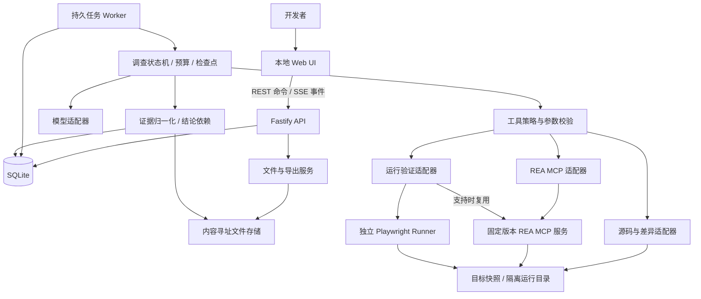
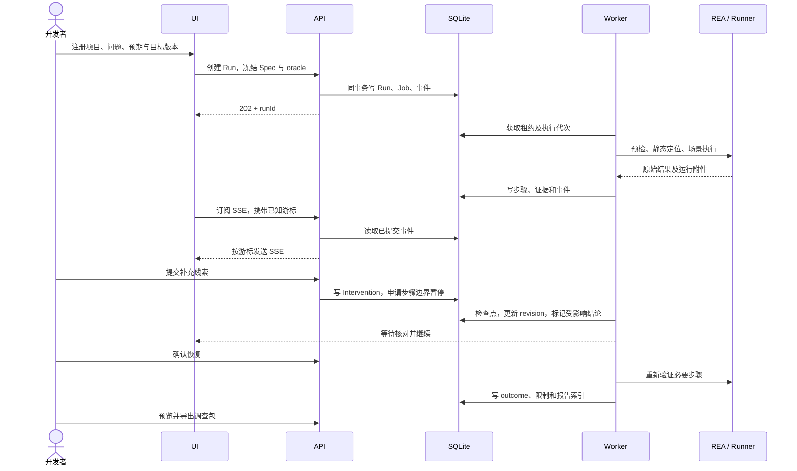
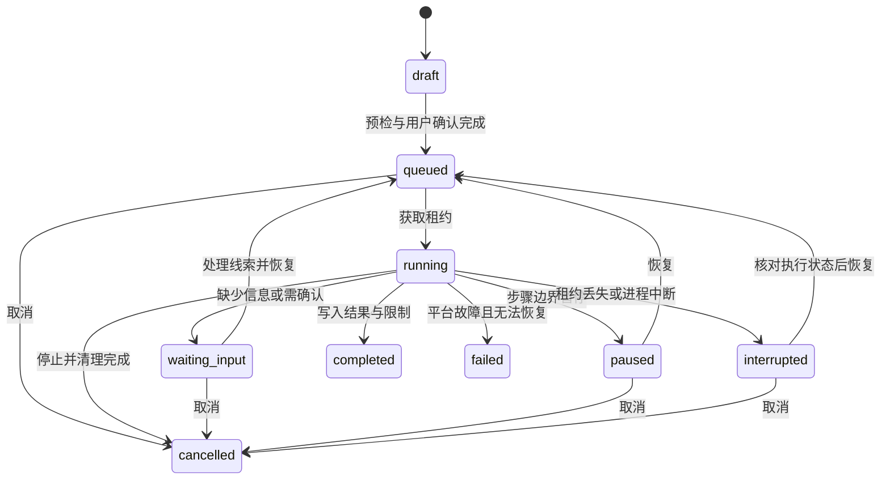

# 软件故障调查工作台：整体架构设计

版本：v0.1 / 日期：2026-10-15 / 状态：待实施设计，尚未完成产品开发或真实目标验证。

本文与 [PRD](01-PRD.md)、[开发计划](03-Development-Plan.md) 配套。本文规定技术合同；需求优先级以 PRD 为准。文中的 `/api/v1`、类型、数据库表、目录与命令都是本产品拟定设计，不是 REA 已有接口。

## 1. 设计范围与关键决策

产品定位：帮助开发者调查 Electron / JavaScript 故障，形成可核对的证据、可重新运行的用例及可交接的调查结果。

| 决策 | v0.1 选择 | 原因与边界 |
| --- | --- | --- |
| 部署 | 单机、单用户、本地 Web UI | 暂不承担多租户云服务复杂度 |
| 首个目标系统 | macOS Apple Silicon | 设计假设，M0 技术验证后确定精确支持矩阵；Windows/Linux 后续增加 |
| 目标项目 | 用户拥有源码或可调试构建，已能在本机启动的 Electron 应用 | 不承诺任意闭源包、原生对话框或线上服务直接可复现 |
| 前后端语言 | TypeScript，pnpm workspace | 前后端共享领域合同，减少跨语言转换 |
| UI | Next.js App Router、React、简单图组件 | 调查时间线与证据面板优先，图只按问题展开 |
| API | Fastify | REST、SSE、命令校验；长任务不在请求处理器执行 |
| 编排 | 显式状态机与持久步骤记录，单 worker、单并发 | 不依赖某个 Agent 框架的内存上下文恢复任务 |
| 存储 | SQLite WAL + 本地内容寻址文件目录 | MVP 无需 Redis、对象存储服务或图数据库 |
| REA | MCP stdio 长连接为主，6.5.0 为候选验证基线；已验证 CLI 为诊断/有限降级 | M0 核对实际安装包与宿主后锁定版本，工具名称、参数和结果按能力清单验证 |
| 运行验证 | RunnerAdapter 优先复用 REA 支持的场景捕获，独立 Playwright Runner 补足断言与测试导出 | 避免重复实现已有捕获能力，也不把工具执行成功当业务验证成功 |
| 模型 | 一个支持结构化工具调用的模型适配器 | 模型负责建议下一步；确定性代码掌握预算、权限和结果判定 |

依赖在 M0 选择互相兼容的具体版本，并提交锁文件。建议从满足 REA 要求的 Node.js 24.x 版本验证，不根据 `latest` 自动升级。Playwright 的 Electron 接口仍被官方标为实验性，因此必须维护目标构建兼容矩阵。[Playwright Electron 文档](https://playwright.dev/docs/api/class-electron)

## 2. 系统边界

### 2.1 复用与自建

| 能力 | 归属 | 设计原则 |
| --- | --- | --- |
| JS/Electron 模块、导入、边界、静态关系 | REA | 保存原始结果及覆盖限制 |
| REA 支持的受控 Electron/browser 捕获、已有比较能力 | REA | 按安装版本和实测能力使用 |
| 目标目录选择、启动配置、双版本配置与期望行为 | 工作台 | 形成用户确认的 InvestigationSpec |
| 场景执行与证据获取的统一入口 | 工作台适配层 | 可以调用 REA，也可调用独立 Runner |
| 旧版通过/新版失败的判定 | 工作台验证器 | 依赖冻结的 oracle、相同输入和可比较前置状态 |
| 人工线索、假设依赖、结论失效与复核 | 工作台 | 不覆盖原始证据 |
| 暂停、恢复、事件流、成本预算 | 工作台 | SQLite 为持久事实来源 |
| 独立回归测试、报告与脱敏调查包 | 工作台 | 无工作台、无模型也能运行已导出的测试 |
| 修复代码、提交和 PR | P1 工作流 | 隔离副本、用户审阅；不影响 P0 闭环 |

REA 是分析与捕获工具层；它的 MCP Session 不替代本产品的持久 Run。官方能力需要对照固定发布版本核实，不能把 main 分支文档全部视为当前安装已支持。[REA 官方仓库](https://github.com/morluto/rea)

### 2.2 外部系统

P0 不接入 GitHub Webhook、Sentry、Slack 或团队账号。用户通过本机路径注册项目；网络只用于用户选定的模型服务和目标应用本身必要的依赖。联网目标可能变化，不能把网络响应录制后简单等同于真实生产环境。

## 3. 组件架构



UI 不直接访问文件系统、REA 或模型密钥。API 和 Worker 为同一台机器的独立进程，共用本地数据库；API 重启不应终止已经登记的长任务。数据库位于本机磁盘，不放到网络共享目录。

本地启动器统一管理Web/API/worker。开发时Next.js将 `/api/v1` 代理到loopback上的Fastify；发布时提供同源入口，禁止把开发端口直接暴露公网。P0可先提供开发者安装包/CLI启动器，不要求先开发Electron桌面壳；具体发布构建方式在M0锁定。

### 3.1 模块职责

| 模块 | 主要输入 | 主要输出 |
| --- | --- | --- |
| project-service | 路径、版本说明、启动描述 | Project、TargetVersion、环境检测报告 |
| investigation-service | 用户问题、输入、oracle、预算 | Case、Run、不可变 SpecRevision |
| scheduler | 可执行 Run、租约 | 单个 Step 的执行权与 fencing token |
| agent-orchestrator | 当前事实、候选步骤、预算 | 经过 Schema 校验的下一步建议 |
| tool-gateway | 内部工具请求、权限范围 | 标准执行记录及原始结果引用 |
| evidence-service | 原始工具结果、源码位置、日志 | 可溯源 EvidenceRecord、Claim、Unknown |
| verification-service | 冻结测试、两个版本、环境指纹 | Observation 与 RunOutcome 候选 |
| intervention-service | 人工补充/纠正、预期 revision | 新线索、失效集合、复核步骤 |
| event-service | 已提交事件表 | 有游标、可断线续传的 SSE |
| export-service | manifest、用户选择的附件 | Markdown、独立测试、脱敏调查包 |

## 4. 调查执行流程



默认从用户给定步骤或模板建立可运行用例。Agent 可以建议补充动作，但不要求先实现通用录屏自动转测试。涉及业务期望、原生对话框 mock 或目标启动配置时，允许进入 `waiting_input`。

## 5. 领域模型

### 5.1 Case、Run 与 Revision

- **Project**：用户授权的源码、构建和输出目录集合。
- **TargetVersion**：不可变目标身份；含源码/构建摘要、架构、依赖锁文件与启动配置摘要。
- **Case**：一个问题及多次调查，保存用户标题和归档属性。
- **Run**：一次预算和 Spec 下的执行；可在检查点恢复。
- **SpecRevision**：问题、输入、oracle、目标和环境策略的不可变版本，由 Run 引用。
- **Intervention**：人工补充或否定，保留作者、目标节点、理由和提交时的 revision。
- **Step**：一个可审计的工具调用或验证动作；记录执行代次和幂等键。
- **EvidenceRecord**：某次观察的来源、内容引用及限制；原始证据只追加。
- **Claim / ClaimAssessment**：可复核结论及其随 revision 变化的评估。
- **Unknown**：仍缺失的信息与下一步所需条件。
- **VerificationAttempt**：在特定版本、输入和环境下执行冻结用例的结果。
- **Artifact / Export**：文件内容摘要和导出清单。

继续调查同一 Spec、处理线索属于恢复同一 Run。`Run.revision` 是调查上下文代次，人工介入应用后递增；`SpecRevision` 是冻结实验规格的独立身份，两者不能混用。修改 oracle、目标二进制或关键环境，必须创建新的 SpecRevision 和新 Run，保留前后联系；不得静默改变原实验。

### 5.2 Run 生命周期与调查结果分离



`completed` 仅代表流程正常收尾，不代表定位成功。`failed` 指工作台内部故障，不用于表示“目标应用报错”或“没有找到原因”。`cancelled` 仅在已核对由本 Run 启动的进程与资源完成清理后写入；清理未确认时进入 `interrupted` 并显示操作状态。

| outcome | 判定条件 |
| --- | --- |
| confirmed_regression | 同一冻结输入/oracle、可比较环境；基线通过，候选版本出现相同业务失败，重复执行符合预设稳定性规则 |
| reproduced_single | 仅单版本验证出与报告一致的业务失败 |
| not_reproduced | 已完成约定尝试但未观察到目标失败；必须附尝试矩阵与覆盖限制 |
| inconclusive | 不稳定、环境不可比、断言不足或业务失败证据不够，不能形成有效复现判定；根因证据不足另由 rootCauseStatus 表达 |
| blocked | 缺少构建、权限、测试数据或用户明确结束等待；说明恢复条件 |

根因另设 `rootCauseStatus = unknown | candidate | verified`。确认版本回归不等于确认根因。只有有针对性的实验、反例控制或修复验证支持，才可将根因标为 `verified`。

### 5.3 用例执行结果

```ts
// 本产品内部合同，非 REA 原生 Schema。
type AttemptResult =
  | { kind: 'pass'; oracleId: string; observations: string[] }
  | { kind: 'application_failure'; signature: string; observations: string[] }
  | { kind: 'harness_error'; code: string; detailRef: string }
  | { kind: 'environment_blocked'; reason: string }
  | { kind: 'timeout'; phase: 'launch' | 'action' | 'oracle'; detailRef: string };
```

Runner 崩溃、找不到元素、超时、启动失败都不能直接充当目标业务失败。测试器须区分执行器异常与应用行为；只有 oracle 明确将某个受控超时定义为被调查行为、并有支撑观察时，验证器才可进一步解释该超时。

## 6. 证据模型与人工介入

### 6.1 两种图分开处理

1. **应用关系图**：模块、IPC、调用、运行实体之间的关系，可以有环。由 REA 或其他适配器提供，保留静态推断与运行观察的区别。
2. **结论依赖图**：问题、证据引用、假设、验证和结论之间的依赖。Claim 的前提依赖要求无环；写入发现循环时拒绝并提示拆分，不能让失效传播无限循环。

界面只展开展示当前问题相关的局部图。工具输入输出、观察与简短决策摘要可展示；不要求获得或保存模型隐藏推理过程。

### 6.2 工作台证据包装

```ts
interface EvidenceRecord {
  id: string;
  runId: string;
  stepId: string;
  revision: number;
  specRevisionId: string;
  authority: 'artifact' | 'static_analysis' | 'runtime' | 'user_assertion';
  epistemicState: 'observed' | 'inferred' | 'unknown' | 'unavailable';
  rawArtifactId: string;
  sourceLocation?: {
    projectRelativePath?: string;
    symbol?: string;
    line?: number;
    captureId?: string;
    timestampMs?: number;
  };
  limitations: string[];
  adapterVersion: string;
  upstreamResultSchema?: string;
}
```

这是工作台统一合同。REA 的完整原始结果独立保存，既不假定上游必有这些字段，也不丢掉上游额外字段。规范化失败时保留原始附件并标记不可用，不能让模型猜测缺失字段。

静态 import/IPC 匹配只证明静态关系推断；不能据此声称该分支已经执行。用户断言可以作为调查线索，但不能自动升级为运行事实。[REA JavaScript Application Graph](https://github.com/morluto/rea/blob/rea-agents-6.5.0/docs/javascript-application-graph.md)

### 6.3 人工纠正协议

1. API 以 `expectedRevision` 和幂等键记录介入，返回 `202 accepted`，此时不承诺已经影响 Agent。
2. 对运行中任务设置暂停请求。Worker 在当前步骤结束或受控停止后建立检查点。
3. 原始结果可保存为历史观察，但旧 revision 的结果不能更新新 revision 的有效结论。
4. 在事务中增加 revision，追加 `user_assertion`，建立 `contradicts` 或 `qualifies` 关系。
5. 从被修改前提出发计算依赖闭包，追加 `needs_reverification` 评估；不删除原证据。
6. 用户核对受影响范围后恢复；只安排必要步骤，保留无关且仍适用的观察。
7. 复核成功后追加新评估；被证伪的结论保留历史并标记 `refuted`。

反馈必须显示 `accepted / applied / rejected`，并解释被拒绝的 revision 冲突或无效目标。用于控制流的“跳过某段代码”是范围调整，不是“这段代码正确”的证据。

ClaimAssessment的状态统一为 `proposed / supported / verified / needs_reverification / refuted`：分别表示候选、有支持材料、通过相应验证、上下文变化需复核、已有反证。状态必须带验证范围与来源，不能把一个节点的verified传播成整条链路正确。

## 7. 调度、恢复与一致性

### 7.1 SQLite 持久队列

每个 Job 保存 `state、lease_owner、lease_until、generation、attempt_count、next_attempt_at`。单 worker 通过短事务原子领取 Job，同时递增 generation。数据库设置 WAL、外键校验与有界 busy timeout；保持写事务短小，不在事务中等待模型或工具。[SQLite WAL 文档](https://sqlite.org/wal.html)

建议初始工程参数：心跳 5 秒、租约 30 秒、调度扫描 1 秒。这些是实现起点，需故障注入验证，不是性能承诺。机器休眠或时钟异常后重新核对进程和租约，不假设任务仍安全运行。

所有步骤结果提交使用 `runId + jobId + generation + expectedRevision` 条件写入，并校验租约未过期。一个事务先获取有效执行权，再写入步骤、证据和事件；条件不符时整个事务回滚，不能先插证据再检查。旧 Worker 即使迟到返回，也只能留下孤立暂存文件，由清理器回收，不能覆盖当前结论。

API 和 Worker 通过同一个 storage repository 执行这些短事务，SQLite 串行化写入；不在前端或任意适配器直接写库。fencing 只能防旧结果落库，不能撤销已发出的外部动作。新执行者恢复前必须核对并清理旧执行者拥有的目标进程，无法确认时保持 interrupted，避免并行重复副作用。

### 7.2 投递语义与幂等

队列按至少一次执行设计，不宣称 exactly-once。每个步骤有唯一逻辑键；同一有效结果只能提交一次。

| 步骤 | 中断后的处理 |
| --- | --- |
| 静态读取/分析 | 目标摘要一致且调用可安全重试时重新执行 |
| 场景运行 | 先终止/核对本 Run 拥有的进程，重置隔离状态，再开始一个新的 Attempt |
| 写文件或修复动作 | 核对输出摘要及操作记录；结果未知时等待人工处理，不盲目重复 |
| 导出 | 以 exportId 写临时目录，完整校验后原子重命名 |
| 模型调用 | 可以重新请求，但记录新调用及费用；不假定输出相同 |

### 7.3 检查点

检查点保存 SpecRevision、有效证据集合、待执行步骤、模型上下文摘要、输入请求与预算余额。MCP Session 和浏览器/进程句柄不属于可序列化检查点；恢复时重建连接，按目标摘要重新挂载所需材料。

- **浏览历史**：只读取已存事件与附件，无执行副作用。
- **恢复调查**：同一 Run 从确认的步骤边界继续，可能需重新启动目标。
- **重新运行测试**：活跃 Run 内的计划重复验证或中断重试创建新的 VerificationAttempt；对已 completed/failed/cancelled 的调查执行用户重跑时创建新 Run，可复用原 SpecRevision，原结果保持封存。
- **重新规划调查**：创建新 Run；模型输出和运行行为可能变化。

“可重跑”仅承诺步骤、输入、断言和依赖可检查、可执行；不承诺联网应用或模型输出逐字、逐帧确定性一致。

### 7.4 事件与 SSE

步骤状态、证据索引和对应事件在同一个 SQLite 事务提交。`events` 表同时作为持久事件日志和 outbox；API 的事件泵读取已提交记录，推送失败不回滚业务事务。

每个 Run 有严格递增 `seq`。GET 快照在同一个读事务内读取业务状态与 `snapshotSeq`，客户端从该游标之后订阅；事件泵持续从持久日志读取，不能只靠内存订阅。客户端使用 `Last-Event-ID` 断线续传，按 `runId + seq` 去重。默认保留 Run 全部事件至用户删除，P0 不做压缩；恢复游标无效时返回明确错误，让 UI 获取快照后重新订阅。订阅端慢时可合并纯进度消息，但不丢状态、人工输入或结论变化。

建议事件：`run.state_changed`、`step.started`、`step.completed`、`evidence.added`、`claim.assessment_changed`、`input.requested`、`intervention.accepted`、`intervention.applied`、`verification.recorded`、`export.ready`。

## 8. 数据库与文件布局

### 8.1 核心表

| 表 | 关键字段 / 约束 |
| --- | --- |
| projects | id、display_name、authorized_roots、created_at |
| target_versions | id、project_id、source_digest、build_digest、launch_spec_digest、environment_digest |
| cases | id、project_id、title、active_run_id、archived_at |
| runs | id、case_id、spec_revision_id、state、outcome、root_cause_status、revision、budget_json |
| spec_revisions | id、case_id、version、spec_artifact_id；唯一 case_id/version；内容不可变 |
| jobs | id、kind、scope_id、run_id（可空）、state、lease_owner、lease_until、generation、attempt_count；包括快照/预检/调查/导出任务 |
| steps | id、run_id、logical_key、revision、generation、status、input_digest、result_artifact_id |
| evidence | id、run_id、step_id、authority、epistemic_state、raw_artifact_id、normalized_json |
| claims | id、run_id、statement、created_revision |
| claim_assessments | id、claim_id、revision、status、supporting_refs、limitations；只追加 |
| claim_dependencies | premise_id、dependent_id、relation；写入校验无环 |
| interventions | id、run_id、expected_revision、payload、state、author、applied_revision |
| input_requests | id、run_id、kind、prompt、state、response_ref |
| verification_attempts | id、run_id、target_version_id、test_digest、fixture_digest、environment_digest、result_json |
| artifacts | id、sha256、relative_blob_path、size、mime_type、sensitivity、created_at |
| artifact_refs | artifact_id、owner_type、owner_id；用于删除与垃圾回收 |
| exports | id、run_id、profile、state、manifest_artifact_id |
| events | run_id、seq、type、payload、created_at；唯一 run_id/seq |
| command_dedup | scope、idempotency_key、request_digest、response_json；唯一 scope/key |

不要将大日志、视频或完整工具输出塞进 SQLite。数据库只保存结构化索引及文件引用。存储实现可用 SQLite 驱动 + SQL migration，M0 锁定具体驱动；业务代码通过 repository 接口隔离驱动。

### 8.2 文件布局

```text
<user-selected-data-dir>/
  db/workbench.sqlite
  blobs/sha256/<prefix>/<digest>
  staging/<run-id>/<step-id>/
  runs/<run-id>/
    workspaces/baseline/
    workspaces/candidate/
    profiles/<attempt-id>/
  exports/<export-id>/
  logs/
```

文件落盘先写 staging、计算摘要、原子移入 blobs，再提交数据库引用。进程崩溃产生的未引用 blob 在宽限期后回收。删除 Case 时撤销引用；共享 blob 仅在无引用时删除。SQLite 备份使用支持的一致性备份方式，不能只复制活跃数据库主文件并漏掉 WAL。

目标快照使用本产品管理的副本或无 checkout 副作用的 Git 导出，避免修改用户当前分支。存在未提交改动时提供“指定 commit”或“当前目录快照”选项，后者记录文件内容摘要。符号链接越界不自动跟随，二进制与依赖不根据 commit SHA 猜测相同。

## 9. 内部适配合同

```ts
interface ReaAdapter {
  discover(signal: AbortSignal): Promise<CapabilityManifest>;
  execute(request: InternalAnalysisRequest, context: StepContext): Promise<RawToolResult>;
  close(): Promise<void>;
}

interface ScenarioRunner {
  preflight(target: TargetVersion, spec: ScenarioSpec): Promise<ReadinessReport>;
  run(target: TargetVersion, spec: FrozenTestSpec, context: StepContext): Promise<AttemptRecord>;
  cleanup(ownership: ProcessOwnership): Promise<CleanupReport>;
}

interface ModelAdapter {
  proposeNextStep(context: BoundedContext, tools: ToolDescription[]): Promise<ValidatedProposal>;
}
```

这些名字都是内部合同，不是上游 MCP 工具名。CapabilityManifest 记录 REA 包版本、工具清单与 Schema 摘要、宿主、可用 provider、实测探针结果。应用启动时读取；每个 Run 保存快照。

### 9.1 MCP 与兼容性

- 每个 Run 单独管理 REA Session，P0 同时仅一个活跃 Run。
- 初始化协商后调用 `tools/list` 获取真实 Schema；内部操作映射只能使用已验证参数。
- 发现工具不意味着运行环境可用；静态探针和小型 capture 探针分别验证。
- 固定支持版本，升级后先跑合同测试和 fixture；不能静默切换至新 Schema。
- 工具返回 `isError`、部分结果、未知字段或大内容时，分别记录，避免把所有文本拼成“成功”。
- CLI 降级只覆盖具有相同已验证语义的操作，不臆造 `rea ...` 命令，不自动更改调查含义。
- MCP 断开后重建 Session，再恢复步骤；不承诺浏览器状态或 provider 句柄仍有效。

6.5.0 文档中可作为 M0 验证入口的真实工具名如下；这里只是接入清单，精确参数以安装包的 `tools/list` 为准：

| 内部能力 | 上游工具候选 | 不能跨越的边界 |
| --- | --- | --- |
| 宿主与工具就绪 | `binary_session` | 工具被枚举不等于provider就绪 |
| JS/Electron静态分析 | `analyze_javascript_application`、`inspect_analysis_view` | summary/view不代表执行覆盖 |
| 静态功能追踪与版本图差异 | `trace_application_feature`、`compare_application_versions` | 图差异不等于实际行为回归 |
| Electron主动场景 | `capture_electron_scenario` | 动作覆盖有限，不完整采集任意IPC payload |
| 静态/运行关联 | `reconcile_javascript_runtime` | 仅能做证据支持的partial映射，不能凭关联推出因果 |
| 证据取回与导出 | `get_evidence_bundle`、`export_evidence_bundle` | retained引用只属于当前连接，不是本产品持久ID |

参考：[固定tag的JS工作流](https://github.com/morluto/rea/blob/rea-agents-6.5.0/docs/javascript-application-workflows.md)、[Electron观察](https://github.com/morluto/rea/blob/rea-agents-6.5.0/docs/electron-observation.md)。

Evidence-producing工具成功结果从 `structuredContent.normalized_result` 与 `structuredContent.evidence_id` 读取；工具失败应检查 `isError` 和文本错误载荷，不能只看Promise是否resolve。保存完整原始结果，单独建立产品索引。REA连接内ledger及 `close_binary` 的清理语义要求本产品持久保存bundle；只在具体工具明确支持时使用retained输入，重连后不可复用旧retained ID。[固定tag的MCP合同](https://github.com/morluto/rea/blob/rea-agents-6.5.0/docs/mcp-contracts.md)

### 9.2 捕获与独立测试

先将用户动作表达为有限的 ScenarioSpec；若 REA 的固定版本覆盖这些动作，则复用其捕获。导出测试从工作台保存的动作、选择器、fixture 和 oracle 生成，不把私有工具日志当可执行程序。

无法稳定生成选择器、原生弹窗无法自动化、应用 fuse 限制调试时，请求用户补充适配或标记 blocked。对原生对话框的 stub 必须写入 manifest，并注明该测试没有验证真实 OS 对话框行为。Playwright 官方对 Electron 的已知限制提供了相应说明。[Playwright Electron 文档](https://playwright.dev/docs/api/class-electron)

### 9.3 模型与预算

模型只从有限动作集合中建议下一步。后端验证目标、参数、依赖、权限、预算和 revision 后执行。结果文本、源码注释和网页内容一律作为调查材料，不可提升为平台指令。

初始默认预算建议：30 个工具步骤、20 分钟主动执行、单步骤独立超时、两次相同无新增证据结果后请求输入。它们是可配置产品参数；显式用户超时优先，预算等待人工输入时不累计主动执行时长。模型usage按provider实际返回记录；金额需要同时具备明确费率与usage才能估算。无法取得费用时显示未知，仍执行步骤数、执行时长与配置token上限，不能声称已经精确执行金额预算。

## 10. API 设计

API 版本：`/api/v1`。创建、启动、介入、恢复、取消、导出均支持 `Idempotency-Key`。同一 key、不同请求摘要返回 `409 IDEMPOTENCY_CONFLICT`。更新 Run 要携带 `expectedRevision`；冲突返回当前 revision。

| 方法与路径 | 用途 | 返回 |
| --- | --- | --- |
| GET /health | 进程健康，不包含密钥 | 200 |
| GET /capabilities | 工作台与 REA readiness | 200 |
| GET /projects | 本机项目列表 | 200 |
| POST /projects | 注册用户授权的本机根目录 | 201 |
| POST /projects/:id/targets | 建立目标版本快照 | 202 |
| GET /projects/:id/targets/:targetId | 读取快照任务、摘要与readiness | 200 |
| GET /cases | 调查列表，按projectId筛选 | 200 |
| POST /cases | 创建问题 | 201 |
| POST /cases/:id/runs | 创建草稿 Run | 201 |
| POST /runs/:id/preflight | 检查启动、fixture、oracle、能力 | 202 |
| POST /runs/:id/start | 冻结 Spec 并排队 | 202 |
| GET /runs/:id | 获取状态、结果、revision、快照游标 | 200 |
| GET /runs/:id/events | 从 Last-Event-ID 订阅 SSE | 200 text/event-stream |
| GET /runs/:id/graph | 获取当前问题局部图与 revision | 200 |
| POST /runs/:id/pause | 请求步骤边界暂停 | 202 |
| POST /runs/:id/interventions | 接受补充或纠正 | 202 |
| POST /runs/:id/resume | 核对检查点并重新排队 | 202 |
| POST /runs/:id/cancel | 请求清理并取消 | 202 |
| GET /artifacts/:id | 授权后读取附件；不接受任意路径 | 200 / 206 |
| POST /runs/:id/exports | 生成某个脱敏 profile 的预览包 | 202 |
| GET /exports/:id | 读取 manifest、缺失项与导出状态 | 200 |
| GET /exports/:id/download | 下载已审阅版本 | 200 |
| DELETE /cases/:id | 清理引用及关联数据 | 202 |

`202` 只代表请求已持久化。UI 通过事件或 GET 查询实际完成。重试不创建重复 Run、重复执行或重复导出。

```json
{
  "code": "REVISION_CONFLICT",
  "message": "调查已更新，请先获取最新状态",
  "requestId": "req_demo",
  "details": { "expectedRevision": 4, "currentRevision": 5 }
}
```

P0 采用同源 UI/API。浏览器 SSE 使用同源会话 cookie；会话由本机启动器通过一次性 bootstrap 机制建立。敏感 token 不放在 SSE URL、持久日志或导出包。

## 11. 比较实验与验证规则

### 11.1 冻结对象

执行前冻结以下摘要：测试代码、oracle、fixture、baseline/candidate 目标、启动参数和环境策略。运行过程中模型不能直接改断言或应用来“通过测试”。修复验证作为 P1 新目标、新 Run，复用同一测试摘要。

### 11.2 可比性

比较记录 OS/架构、Electron/Node、应用构建、依赖锁、用户目录初始状态、时间/时区、locale、网络策略、文件权限、输入及 stub。两个版本必须在独立用户目录和输出目录运行；每次 Attempt 从相同 fixture 重置。

策略区分：

- **仅应用差异**：依赖与运行时均固定，尽量缩小变化范围。
- **整体发布包差异**：应用及自带 Electron/依赖随版本变化。可以确认发布回归，但不能直接归因某一代码修改。

预设检查 3 次/版本且每次重置状态；基线 3/3 通过、候选 3/3 出现同一目标失败且无 harness error，才进入 confirmed_regression 的默认规则。此处是 v0.1 验收规则，不是统计置信保证。混合结果保留矩阵并标为 inconclusive；用户选择更少尝试时，结论明确标为初步观察，不能沿用默认稳定性标签。

### 11.3 归因与反例

报告必须分开写“已复现行为”“根因候选”“支持/反驳证据”“未覆盖条件”。候选位置不自动等于因果关系；可通过固定其他变量、改变一个条件、对照输入或修复后的同用例验证增强归因。

## 12. 调查包合同

```text
case-export/
  manifest.json
  report.md
  scenario.json
  tests/reproduction.spec.ts
  fixtures/<selected-files>
  evidence/index.json
  evidence/<redacted-attachments>
  environment.example.json
  package.json
  pnpm-lock.yaml
  README.md
```

manifest 包含 `schemaVersion、caseId、runId、revision、target digests、test/oracle/fixture digests、tool versions、environment summary、attempt results、limitations、file checksums、redaction log、missing prerequisites`。

脱敏创建派生附件及新的内容摘要，记录源附件摘要与脱敏操作；不能原地修改REA canonical Evidence后仍声称保持原始身份。共享包若不包含原件，应明确证据完整性核验的限制，不能只凭原摘要核验派生内容。

P0 导出的是可阅读、可独立运行测试的包，不支持把外部调查包直接导入并恢复内部任务。重跑可以依赖用户本地重新提供目标程序和秘密值；manifest 明确列出这些前提。默认不带应用二进制、整个仓库、认证状态或安装依赖目录。

执行步骤应写成标准 package scripts；脚本只使用公开运行依赖，不请求模型、不依赖工作台 API。开发时在干净测试目录安装锁定依赖并验证，不把尚未执行的生成脚本称为“验证通过”。

## 13. 权限与数据边界

- 服务只监听 loopback，校验 Host/Origin、同源会话和写请求 CSRF token；不启用 `Access-Control-Allow-Origin: *`。本地网页来源不能任意操作服务。
- 目标目录在注册时 canonicalize 并检查符号链接，读取与写入范围分离；展示路径可以相对化，原始定位不能被截断后用于执行。
- 启动命令使用可执行文件与参数数组，`shell: false`。自定义脚本需用户明确登记；模型不能获得任意 shell 字符串执行器。
- P0 面向用户信任且有权运行的项目；本机应用与脚本仍使用该用户权限运行。工作目录隔离和进程清理不构成恶意程序安全沙盒。
- 按 process ownership 记录 PID、启动时间、进程组和 Run；只停止本产品启动且核对归属的进程，防 PID 重用。
- 模型 key 存 OS Keychain 或由启动环境注入，不入 SQLite 明文与导出。云模型接收的内容由发送策略控制；本地执行不等于分析片段不发送到模型服务。
- 工具原始输出、日志和截图可能含敏感数据。发送模型前应用文本筛选；未审阅截图不发送外部视觉模型。导出预览使用脱敏后的独立副本。
- 默认导出移除 Cookie、Authorization、token、用户主目录和未选择的源码内容。截图/视频默认不纳入共享包；用户预览、选择遮罩后再加入。不能承诺自动脱敏识别一切秘密。
- 删除只承诺清除本产品可管理的数据及引用，不声称 SSD 安全擦除或撤回已发往模型服务的数据。

## 14. 非功能目标与运行观测

以下是待验证的工程目标：

| 项目 | v0.1 目标 / 测试条件 |
| --- | --- |
| 命令受理 | 本机空闲、非文件扫描操作，P95 小于 500ms |
| 事件呈现 | 事务提交后，正常本机负载下 1 秒内可见 |
| UI 数据量 | 500 个节点的局部图，超过后分页/折叠；大日志分段读取 |
| 中断恢复 | Worker 被杀后能检测 interrupted，核对后恢复；不丢已提交步骤与事件 |
| 并发 | 一个活跃 Run；其余排队，UI 显示等待原因 |
| 资源 | 每次步骤具有时间/输出大小限制；视频与trace按配置采集 |
| 审计 | 任一有效结论可追至 Spec、步骤、工具版本、原始结果及人工输入 |

指标包括队列等待、步骤耗时、模型 usage、工具错误率、取消清理耗时、失效结论数、复核次数、归一化失败数、未引用 blob 数。日志默认不记录凭据和完整目标文件；诊断附件由用户选择导出。

## 15. 代码组织

```text
apps/
  web/                    # Next.js 页面、证据面板、事件消费者
  api/                    # Fastify 路由、会话、领域命令
  worker/                 # 调度、步骤执行、恢复
packages/
  domain/                 # 类型、状态机、oracle合同、失效规则
  contracts/              # API/Event JSON Schema与生成类型
  storage/                # SQLite repositories、migration、blob store
  orchestration/          # 有界调查策略、上下文装配、检查点
  adapters-rea/           # MCP/有限CLI适配与合同fixtures
  runner/                 # ScenarioSpec、REA捕获桥、Playwright验证
  model/                  # 首个模型provider、usage与结构化响应
  export/                 # 报告、manifest、脱敏、独立测试模板
  ui/                     # 复用组件
fixtures/
  electron-export-demo/   # 基线、故障版、修复版，人工定义oracle
tests/
  contracts/
  integration/
  e2e/
  recovery/
```

本阶段不引入微服务、Redis、向量数据库、自动多 Agent 编队或 Kubernetes。需要多机/团队功能时，先拆存储与执行节点合同，再迁移数据库与权限模型。

## 16. 主要风险与技术闸门

| 风险 | M0/M1 必须得到的证据 | 降级路径 |
| --- | --- | --- |
| Electron 自动化实验性与构建限制 | 固定宿主上启动、操作、采集、清理真实fixture成功 | 限定可调试源码构建；其他构建只做静态调查 |
| REA 发布与 main 差异 | 锁定包版本、Schema与捕获探针 | 隐藏未验证操作，输出能力缺口 |
| 任意业务操作无法通用录制 | 用户提供步骤可转成稳定测试 | P0 使用模板/手工补selector，不承诺任意录制 |
| 线上环境不可比较 | fixture、网络及状态策略可记录 | inconclusive并解释变量 |
| Agent 推断过度 | 无证据结论被Schema/验证器拦截 | 保留candidate/unknown |
| 进程中断导致重复动作 | 故障注入证明租约与清理规则 | 转interrupted，等待核对 |
| 人工纠正后旧结论仍有效 | 依赖闭包测试与UI验收 | 暂停报告终稿，要求复核 |
| 导出脚本依赖内部服务 | 干净目录离线模型条件下重跑成功 | 导出标注needs_setup，不能标verified |

## 17. 参考与验证说明

资料核对日期：2026-10-15。本文没有安装或执行 REA、Playwright 或目标应用，所有性能与兼容目标均待实施验证。

- [REA 官方仓库](https://github.com/morluto/rea)：工具层定位与宿主要求。
- [REA 6.5.0发布记录](https://github.com/morluto/rea/releases/tag/rea-agents-6.5.0)：候选验证版本；本次未核对npm tarball与本机实测。
- [REA MCP 合同](https://github.com/morluto/rea/blob/rea-agents-6.5.0/docs/mcp-contracts.md)：MCP工具与会话说明；实施时对应固定tag阅读。
- [REA JavaScript Application Graph](https://github.com/morluto/rea/blob/rea-agents-6.5.0/docs/javascript-application-graph.md)：证据来源、静态/运行关系及unknown边界。
- [REA Electron观察](https://github.com/morluto/rea/blob/rea-agents-6.5.0/docs/electron-observation.md)：主动与被动捕获边界。
- [Playwright Electron](https://playwright.dev/docs/api/class-electron)：实验性支持与启动/对话框限制。
- [SQLite WAL](https://sqlite.org/wal.html)：本地数据库并发、备份及文件系统约束。
- [Fastify Server](https://fastify.dev/docs/latest/Reference/Server/)：本地API服务实现参考，非锁定依赖版本。
