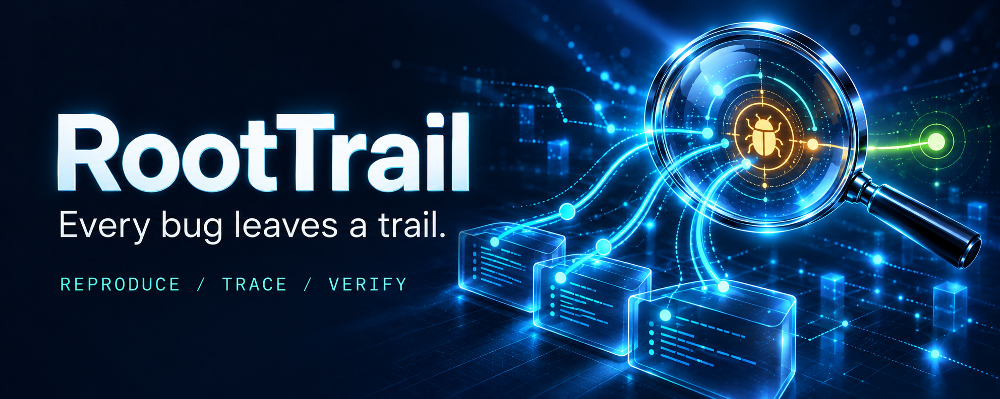
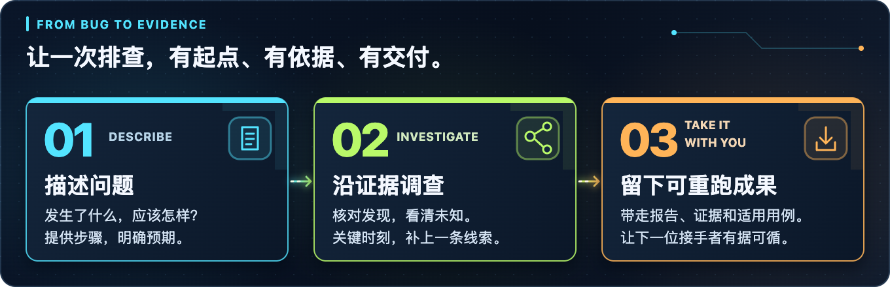

  <a href="README.md">English</a> · <strong>简体中文</strong>

# RootTrail · 寻因

### 让每一个 Bug 都有证据可循。

**把复杂故障，拆成可验证的证据链。**

面向 Electron / JavaScript 开发者的本地优先 AI 故障调查工作台。

**Evidence-Driven Debugging · Cross-Process Investigation · Human-in-the-Loop**

[产品能力](#以证据驱动调查) · [典型场景](#为这些难查的问题而生) · [使用体验](#从问题到证据再到验证) · [调查成果](#一次调查留下可继续的成果)

> 当前为产品概念预览，所述功能尚在规划中；图片为品牌与体验示意。

## 让复杂排查，有一条清晰的路径

一次点击没有响应，背后可能跨越页面事件、桥接接口、进程通信、主进程和文件系统。故障现象只有一处，相关线索却散落在代码、日志、版本变更和开发者经验中。

RootTrail 围绕一个具体 Bug，把**场景复现、行为关联、证据溯源、人工协作和回归验证**组织成连续的调查过程。你可以看到目前发现了什么、哪些判断有依据、还有什么没有查清，并在关键节点介入。

**让现象可复现、线索可追溯、判断可复核、成果可重跑。**

## 以证据驱动调查

### 🔍 根因分析 · Root Cause Analysis

从“实际发生了什么”和“应该发生什么”建立调查上下文，沿相关模块、接口和运行记录逐步检查候选原因，缩小排查范围。

每个候选解释都可以关联支持材料、反证和未解决问题。**复现状态与根因判断分别呈现**，便于判断当前结论的可靠边界。

### 🧭 跨进程行为关联 · Cross-Process Investigation

面向 Electron 应用，围绕 **Renderer → Preload → IPC → Main** 组织相关代码与已采集的运行观察，把原本分散在多个进程中的线索放到同一调查上下文中。

从页面操作追到桥接接口，再检查主进程侧的相关行为。对于尚未观察到的环节，保留明确的覆盖缺口，帮助你决定下一步查哪里。

### ⚖️ 版本差分分析 · Differential Analysis

“旧版正常，新版失败”是调查的重要入口。RootTrail 使用统一的操作步骤、输入和预期行为对照两个版本，展示实际结果与关键环境差异。

适合依赖升级、接口迁移、IPC 改造和导出功能变更后的行为核对。只有一个版本时，也可以开展单版本复现与调查。

### 🧩 证据溯源 · Evidence Provenance

代码引用、日志、运行记录和人工说明各自保留来源，并与相关版本及调查步骤关联。通过调查关系图与时间线，你可以从一个判断回到支撑它的材料。

**直接观察、派生结果、候选推断和未知项分开标记。** 证据不完整时，限制随结论一起展示，让调查过程更具可解释性与可审查性。

### 💬 人机协同 · Human-in-the-Loop

你熟悉业务，Agent 擅长组织线索。调查卡在私有接口、历史约定或特殊业务逻辑时，可以补充背景、否定假设或要求继续验证。

人工输入保留来源；受影响的旧结论进入待复核，原始证据与历史仍然可查。让项目经验真正进入调查过程，也让判断变化有据可循。

### 🔁 可复现验证 · Reproducible Verification

围绕明确的业务预期建立复现场景，保留每次运行的输入、结果和前置条件。在适用场景下，将调查成果转为可重跑的复现脚本与回归测试。

这次查过的问题，可以留下再次验证的入口。导出用例以脱离模型和工作台也能执行为目标，并附带目标应用、依赖和必要数据等运行前提。

## 为这些难查的问题而生

| 你遇到的问题 | RootTrail 帮你组织的调查 |
| --- | --- |
| **版本升级后功能失效** | 对照旧版与新版的同一操作，检查行为差异、环境差异与相关证据。 |
| **按钮无响应，日志散落各处** | 关联页面事件、桥接接口、IPC 与主进程侧线索，检查已观察到的执行环节。 |
| **中文文件名或特殊输入触发异常** | 固定输入与预期结果，保留复现记录，并形成适用的回归用例。 |
| **接手陌生项目，不知道从哪查起** | 从具体故障切入，沿相关代码与运行观察建立问题上下文。 |
| **排查到一半，需要同事接手** | 交付已有证据、执行记录、候选原因和待验证问题。 |

## 从问题到证据，再到验证

1. **明确问题。** 选择本地项目，提供故障现象、触发步骤和预期行为；有正常旧版时，一起加入对照。
2. **参与调查。** 查看时间线、证据关系和候选原因，在关键节点补充业务背景或纠正假设。
3. **带走成果。** 核对调查结果，导出报告、证据索引和适用的验证用例。

例如：“新版无法导出带中文文件名的文件，旧版正常。”围绕同一输入与预期，逐步核对两版行为，检查相关路径，并保留实际运行结果。这是体验示例，不代表已经完成的真实案例。

## 一次调查，留下可继续的成果

| 成果 | 对你有什么用 |
| --- | --- |
| **调查报告 · Investigation Report** | 了解复现情况、候选原因、支持证据与结论边界。 |
| **证据索引 · Evidence Index** | 回到具体代码、版本和运行记录，方便复核与交接。 |
| **复现材料 · Reproduction Artifacts** | 保留步骤、输入、环境前提和适用脚本，减少重新描述问题的成本。 |
| **回归用例 · Regression Tests** | 在可定义明确断言的场景中，留下后续版本可以再次执行的检查。 |
| **未解问题 · Open Questions** | 看清尚未验证的环节与下一步需要补充的材料。 |

暂时没有定位的问题，也能留下已经完成的工作。每次调查都可以成为持续维护与知识交接的一部分。

## 本地优先，边界清楚

调查记录与证据按本地保存设计。使用远程模型服务时，选定的上下文可能发送给该服务。

当前产品范围面向已有可运行源码或可调试构建的 Electron / JavaScript 项目；实际可观察与可复现程度取决于目标应用和运行条件。

分析能力源自 [REA](https://github.com/morluto/rea)，RootTrail 为独立产品。

---

**RootTrail · Follow the evidence. Find the cause.**

让这一次排查，成为下一次的起点。

